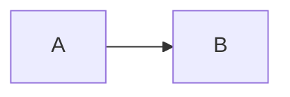

# Documentation

The workshop site is a [Quarkus Roq](https://iamroq.dev/) static site. Roq renders each Markdown page through Qute, so page content is a Qute template before it becomes HTML. Everything lives in this `docs/` directory. There is no Python or MkDocs setup anymore.

## Prerequisites

- Java 21 or newer
- Docker, running. The Roq diagram plugin starts a Kroki container when the site is built, so a build fails without a working Docker daemon.

Use the Maven wrapper from the repository root. There is no wrapper inside `docs/`.

## Run the site locally

From the repository root:

```bash
./mvnw -f docs quarkus:dev
```

Or from this directory:

```bash
../mvnw quarkus:dev
```

The site is available at [http://localhost:8080](http://localhost:8080). Dev mode watches `docs/content`, `docs/web`, `docs/templates` and the Java sources, and regenerates the affected pages on change.

## Build and test

```bash
./mvnw -f docs clean package
./mvnw -f docs test
```

The generated site ends up in `docs/target/roq`. CI builds it with the `quarkiverse/quarkus-roq` GitHub action and deploys it to GitHub Pages from `main`. The workflow is `.github/workflows/build.yml`.

`RoqSiteTest` boots the generator and checks the result: pages render without Qute errors, snippets expand, links and image paths are relative, the sitemap and search index exist, callout boxes keep their content, `<mark>` highlights render, and light mode is the default. Add an assertion there when you change something that the site generation could silently break.

## Where things live

- `docs/content/`: the pages, one Markdown file per page, with YAML front matter (`title`, `layout`, ...). The URL follows the path, so `section-1/step-01.md` becomes `/section-1/step-01/`.
- `docs/public/images/`: screenshots and diagrams.
- `docs/web/_custom.css` and `docs/web/app.js`: workshop styles and scripts, bundled together with the theme's. Frontend files must stay identical in every Section 3 step; check `section-3/README.md` before editing them.
- `docs/templates/`: overrides of the Roq default theme, such as the navbar and the head partial.
- `docs/src/main/resources/templates/`: workshop partials such as the sidebar menu and head scripts.
- `docs/src/main/java/docs/SnippetExtension.java`: the `{snippet:insert(...)}` Qute extension.
- `docs/content/sitemap.xml` and `docs/content/search-index.json`: small templates wired to the Roq plugins.

## Writing pages for this build

Callout boxes use GitHub alerts. A bold first line becomes the box title, as the old `!!! note "Title"` did:

```markdown
> [!TIP]
> **Reloading**
> The application restarts on the next request.
```

Use `> [!NOTE]`, `> [!TIP]`, `> [!IMPORTANT]` and `> [!WARNING]`. For a collapsed box, use plain HTML:

```html
<details>
<summary>Not seeing the logs?</summary>

The explanation goes here, after a blank line.

</details>
```

Action highlights use `<mark>`, not the MkDocs `==...==` delimiter, which Roq's Markdown engine does not support:

```markdown
<mark>Open `application.properties` and add the following:</mark>
```

Page links are relative and end with a slash. Roq does not rewrite `.md` links, so `../step-02.md` would 404:

```markdown
[next step](../step-02/)
```

Images use paths relative to the page:

```markdown

```

Do not use absolute `/images/...` paths. The site is published under `/quarkus-workshop-langchain4j`, so absolute paths break there even when they work on localhost.

Literal braces need escaping because Qute resolves `{...}` before Markdown renders. Write `\{` and `\}` when a brace must stay literal in prose or a code block. Strict rendering is on, so an unresolved expression fails the build with the file and line instead of shipping broken output.

Snippets come from the step projects:

```markdown
{snippet:insert("section-1/step-05/pom.xml")}
{snippet:insert("section-1/step-05/pom.xml", "easy-rag")}
{snippet:insert("section-3/step-05/src/main/java/com/tripplanner/model/TripPlanStore.java:12", "34")}
```

The first form inserts the whole file. The second reads the lines between `--8<-- [start:easy-rag]` and `--8<-- [end:easy-rag]` markers, in `--8<--` or `-8<-` form, inside any comment syntax. The third reads a line range: the first line goes after a colon in the path, the last line is the second argument.

Add `hl_lines` to the fence info string to mark the lines the reader should change. The numbers are one-based lines of the rendered block, so for a line-range snippet they count from the start of the excerpt:

````markdown
```java hl_lines="22-25"
{snippet:insert("section-1/step-03/src/main/java/dev/langchain4j/quarkus/workshop/CustomerSupportAgentWebSocket.java")}
```
````

The lines get a light blue background and a blue bar on the left, faint in dark mode. Put the file name in a bold line above the fence, since the info string only carries the language and `hl_lines`.

Mermaid fences render as diagrams in the browser:

````markdown

````

Mermaid is loaded from jsDelivr, only on pages that contain a diagram, the same approach the previous site used. The version is pinned in `docs/web/app.js`. If the CDN cannot be reached, the diagram source stays visible as a code block, and the diagrams render again with the matching palette when the reader switches between light and dark.

For tone and structure, read `.agents/skills/workshop-docs-style/SKILL.md`.
