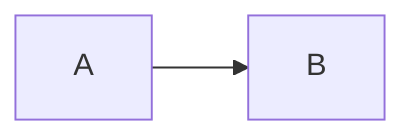

# Documentation

The workshop site is a [Quarkus Roq](https://iamroq.dev/) static site. Roq renders each Markdown page through Qute, so page content is a Qute template before it becomes HTML. Everything lives in this `docs/` directory. There is no Python or MkDocs setup anymore.

## Prerequisites

- Java 21 or newer
- Docker, running. The Roq diagram plugin starts a Kroki container when the site is built, so a build fails without a working Docker daemon.

Use the Maven wrapper from the repository root. There is no wrapper inside `docs/`.

The look is the [quarkus.io theme](https://github.com/quarkusio/quarkusio.github.io#using-the-quarkus-theme-in-your-site), `io.quarkus:quarkus-website-theme`. It is published as a `1.0.0-SNAPSHOT` in the `https://quarkus.io/maven/` repository, which `docs/pom.xml` declares, so the first build needs network access to it. The theme ships the Roq 2.2.x line, which is why the docs module uses Quarkus 3.40.

## Run the site locally

From the repository root:

```bash
./mvnw -f docs quarkus:dev
```

Or from this directory:

```bash
../mvnw quarkus:dev
```

The site is available at [http://localhost:8080](http://localhost:8080). Dev mode watches `docs/content` and `docs/templates` and regenerates the affected pages on change. A stylesheet change in `docs/web/` needs a restart of the dev server; it is not always picked up by live reload.

## Build and test

```bash
./mvnw -f docs clean package
./mvnw -f docs test
```

The generated site ends up in `docs/target/roq`. CI builds it with the `quarkiverse/quarkus-roq` GitHub action and deploys it to GitHub Pages from `main`. The workflow is `.github/workflows/build.yml`.

`RoqSiteTest` boots the generator and checks the result: pages render without Qute errors, snippets expand, links and image paths are relative, the sitemap and search index exist, callout boxes keep their content, `<mark>` highlights render, the Quarkus theme header is in place, and pages get the workshop layout. Add an assertion there when you change something that the site generation could silently break.

## Where things live

- `docs/content/`: the pages, one Markdown file per page, with YAML front matter (`title`, `layout`, ...). The URL follows the path, so `section-1/step-01.md` becomes `/section-1/step-01/`.
- `docs/public/images/`: screenshots and diagrams.
- `docs/web/main.scss` and `docs/web/app.js`: workshop styles and scripts. `main.scss` imports the Quarkus theme first and then the workshop rules. Frontend files must stay identical in every Section 3 step; check `section-3/README.md` before editing them.
- `docs/templates/theme-layouts/quarkus/`: the `page` and `home` layouts that put the navigation column, the prose and the table of contents on the theme's `base` layout.
- `docs/templates/layouts/base.html`: overrides the theme's head and scripts to load its assets through the site root path, and adds the lunr search overlay.
- `docs/src/main/resources/templates/partials/quarkus/`: the header and footer partials that replace the theme's. The header is the workshop's own row: Quarkus logo, workshop name, search, repository links and the colour toggle.
- `docs/src/main/resources/templates/partials/workshop/`: the sidebar menu and its scripts.
- `docs/data/projectfooter.yaml`: the footer content the theme renders.
- `docs/src/main/java/docs/SnippetExtension.java`: the `{snippet:insert(...)}` Qute extension.
- `docs/content/sitemap.xml` and `docs/content/search-index.json`: small templates wired to the Roq plugins.

## Working with the theme

The theme provides the header row, footer, colours, grid and colour-mode script. Three of its rules need care when you touch the header or the prose:

- It sets `* { color: #000 }`, which overrides inheritance everywhere and makes light text on dark backgrounds invisible. Content colours are set explicitly in `main.scss`; the same applies to any new element with white or inherited text.
- It floats every `nav` (`nav { float: right }`) and floats nav list items. A header row needs a containing context (`display: flex` on `.nav-wrapper`, `float: none` on the nav), and any `<nav>` used for the table of contents needs its list items unfloated.
- It loads its own assets as absolute `/assets/...` URLs, from `colormode.js` to the logos. Under the GitHub Pages root path those 404, so our templates use `site.url.fromRoot(...)` for them.

Code blocks use the `github-dark` style from `app.js` in both colour modes, with the block background set in `main.scss`.

## Writing pages for this build

Callout boxes use GitHub alerts. A bold first line becomes the box title, as the old `!!! note "Title"` did:

```markdown
> [!TIP]
> **Reloading**
> The application restarts on the next request.
```

Use `> [!NOTE]`, `> [!TIP]`, `> [!IMPORTANT]` and `> [!WARNING]`. For a collapsed box, use plain HTML. The class sets the colour: `note` or `info` (blue), `warning` (amber) or `important` (purple). Keep the body unindented and leave a blank line before `</details>`, or it ends up outside the box:

```html
<details class="warning">
<summary>Not seeing the logs?</summary>

The explanation goes here, after a blank line.

</details>
```

Tables, alerts, autolinks and heading ids come from commonmark extensions that `docs/src/main/java/docs/MarkdownExtensions.java` registers. `quarkus-qute-web-markdown` only adds them itself while the project defines no `org.commonmark.Extension` bean of its own, and `HighlightLinesExtension` is one, so keep `MarkdownExtensions` when you add or remove Markdown extensions.

Search is the lunr plugin's own: `{#search-button-input /}` in the header, and `{#search-overlay /}` plus `{#search-script /}` in `docs/templates/layouts/base.html`.

Action highlights use `<mark>`, not the MkDocs `==...==` delimiter, which Roq's Markdown engine does not support:

```markdown
<mark>Open `application.properties` and add the following:</mark>
```

Page links are relative and end with a slash. Roq does not rewrite `.md` links, so `../step-02.md` would 404:

```markdown
[next step](../step-02/)
```

Images use paths relative to the page:

```markdown

```

Do not use absolute `/images/...` paths. The site is published under `/quarkus-workshop-langchain4j`, so absolute paths break there even when they work on localhost.

Literal braces need escaping because Qute resolves `{...}` before Markdown renders. Write `\{` and `\}` when a brace must stay literal in prose or a code block. Strict rendering is on, so an unresolved expression fails the build with the file and line instead of shipping broken output.

Snippets come from the step projects:

```markdown
{snippet:insert("section-1/step-05/pom.xml")}
{snippet:insert("section-1/step-05/pom.xml", "easy-rag")}
{snippet:insert("section-3/step-05/src/main/java/com/tripplanner/model/TripPlanStore.java:12", "34")}
```

The first form inserts the whole file. The second reads the lines between `--8<-- [start:easy-rag]` and `--8<-- [end:easy-rag]` markers, in `--8<--` or `-8<-` form, inside any comment syntax. The third reads a line range: the first line goes after a colon in the path, the last line is the second argument.

Add `hl_lines` to the fence info string to mark the lines the reader should change. The numbers are one-based lines of the rendered block, so for a line-range snippet they count from the start of the excerpt:

````markdown
```java hl_lines="22-25"
{snippet:insert("section-1/step-03/src/main/java/dev/langchain4j/quarkus/workshop/CustomerSupportAgentWebSocket.java")}
```
````

The lines get a light blue background and a blue bar on the left, faint in dark mode. Put the file name in a bold line above the fence, since the info string only carries the language and `hl_lines`.

Mermaid fences render as diagrams in the browser:

````markdown

````

Mermaid is loaded from jsDelivr, only on pages that contain a diagram, the same approach the previous site used. The version is pinned in `docs/web/app.js`. If the CDN cannot be reached, the diagram source stays visible as a code block, and the diagrams render again with the matching palette when the reader switches between light and dark.

For tone and structure, read `.agents/skills/workshop-docs-style/SKILL.md`.
