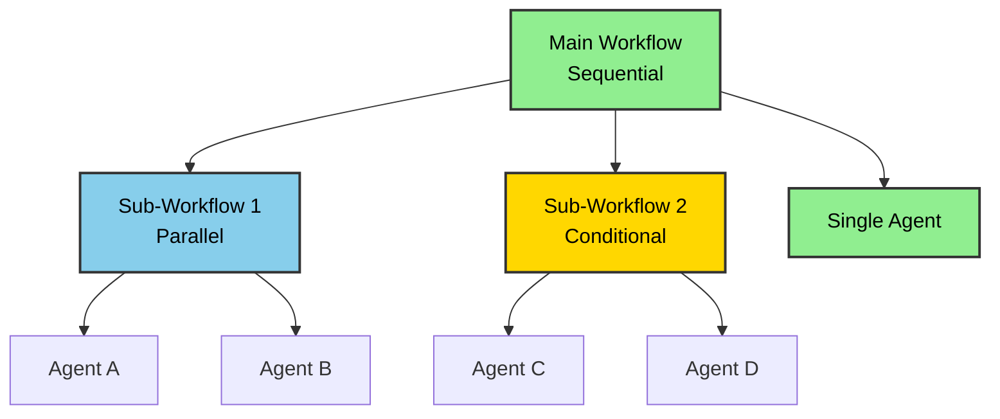
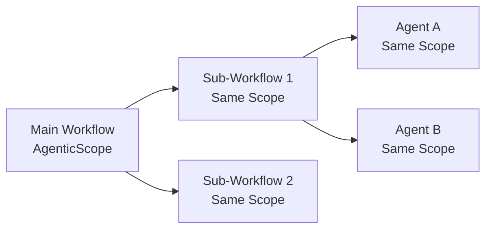
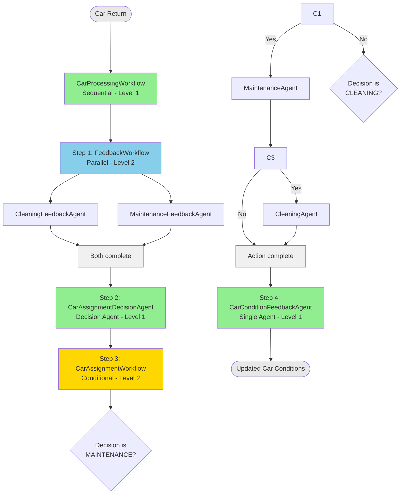
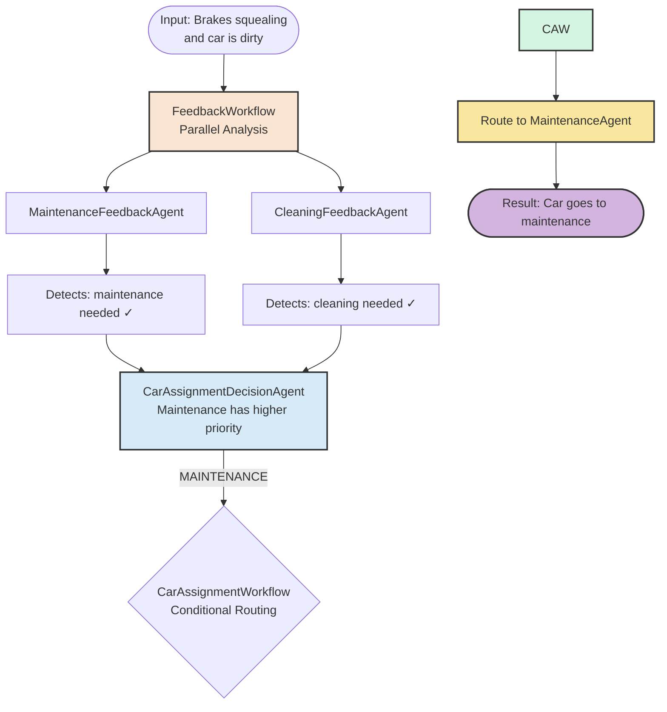
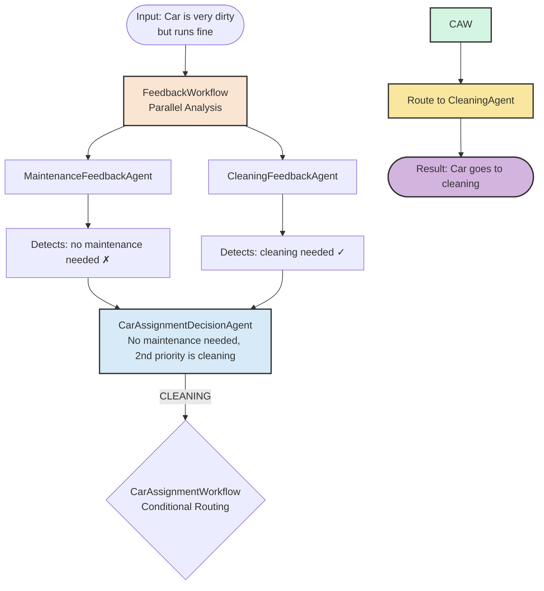
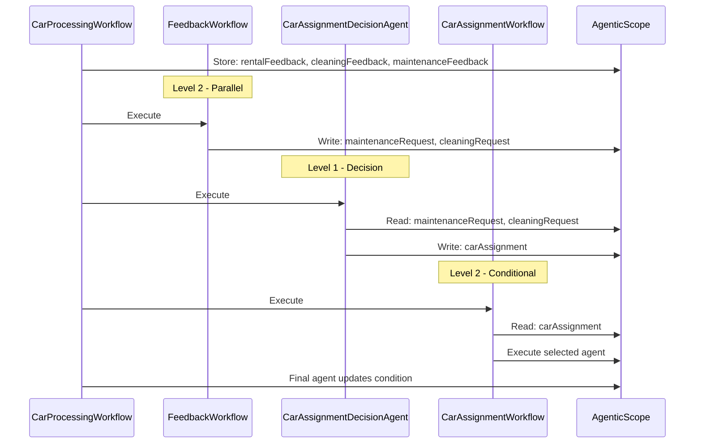

# Step 03 - Composing Multiple Agentic Workflows

## Composing Multiple Agentic Workflows

In the previous step, you created a **sequential workflow** that orchestrated two agents working together:

1. The `CleaningAgent` determined if a car needed cleaning
2. The `CarConditionFeedbackAgent` updated the car's condition based on feedback

A single sequential pattern works well when you just need agents to run one after another.
However, real-world scenarios often require more sophisticated orchestration patterns.

In this step, you'll learn how to **compose workflows by nesting them within other workflows** to build complex agentic systems. You'll create multi-level orchestration patterns that combine different execution patterns (sequential, parallel, and conditional).

---

## New Requirement from Miles of Smiles Management: Comprehensive Car Management

The Miles of Smiles management team wants a more sophisticated car management system.
When cars are returned, they want the system to automatically:

1. **Analyze feedback** for both cleaning needs AND maintenance requirements **simultaneously**
2. **Route cars** appropriately to maintenance if needed, otherwise to cleaning if needed
3. **Track all feedback sources** from rentals, cleaning, and maintenance teams
4. **Update car conditions** based on all collected feedback

These new features require more advanced orchestration between agents to route requests appropriately.

---

## What You'll Learn

In this step, you will:

- Understand how to **nest workflows within workflows** to create sophisticated multi-level orchestration
- Explore additional types of workflow patterns such as **parallel** and **conditional**
- Use a **decision agent** to get a typed answer from a decision model and route each car with it
- See how `AgenticScope` flows through nested workflow levels

---

## Composing Agentic Workflows

Let's start with a bit of theory. In [Step 02](../step-02/), you learned about the four fundamental workflow patterns: sequential, parallel, conditional, and loop. Now we'll explore how to **compose these patterns** by nesting workflows within other workflows.

### What is Agentic Workflow Nesting?

Workflow nesting means using a workflow as a sub-agent within another workflow. This allows you to:

- **Combine patterns**: Use parallel execution within a sequential flow
- **Organize complexity**: Break down complex orchestration into manageable pieces
- **Reuse workflows**: Use the same sub-workflow in multiple places
- **Create hierarchies**: Build multi-level agent systems

### Example: Nested Agentic Workflow Architecture



This creates a **three-level nested workflow** where:

- The main sequential workflow coordinates the overall flow
- Sub-workflows handle specific orchestration patterns (parallel, conditional)
- Individual agents perform specific tasks

### How AgenticScope Works with Nesting

When workflows are nested, the `AgenticScope` flows through all levels:



**Key points:**

- All nested workflows and agents share the **same `AgenticScope` instance**
- Data written by any agent is available to all subsequent agents
- The scope maintains state throughout the entire execution hierarchy

---

## What is Being Added?

Now that we have that bit of theory under out belt, we can continue to transform our car management system.
We're going to implement:

- **3 feedback sources**: collect *human* feedback not only from the car rental returns team, but also from the cleaning team, and from the maintenance team
- **Parallel analysis**: do concurrent evaluation for both cleaning and maintenance needs
- **Conditional routing**: implement intelligent decision-making about where to send each car
- **Update the system**: add additional Tools the agents can call to update the car conditions in the database based on all feedback

### The Complete Solution Architecture

The final system uses a 3-level nested workflow, similar to what we saw above in the theoretical part:



**The Flow:**

1. **FeedbackWorkflow** (Parallel): Analyzes feedback simultaneously from two perspectives:
    - Does the car need maintenance?
    - Does the car need cleaning?

2. **CarAssignmentDecisionAgent** (Decision) reads both analyses and chooses the team that handles the car next. It answers maintenance if any maintenance is required, otherwise cleaning if any cleaning is required, and otherwise that no action is needed.

3. **CarAssignmentWorkflow** (Conditional) activates the agent that matches this answer, which is either the `MaintenanceAgent` or the `CleaningAgent`. When no action is needed it activates neither of them, and the flow continues.

4. **CarConditionFeedbackAgent** (Single): Updates the car's condition based on all feedback

---

### Key Implementation Details

### How Each Level Works

#### Level 1: Main Sequential Workflow

The `CarProcessingWorkflow` orchestrates the entire process sequentially:

**CarProcessingWorkflow.java**
```java hl_lines="1-2"
{snippet:insert("section-2/step-03/src/main/java/com/carmanagement/agentic/workflow/CarProcessingWorkflow.java", "sequence-agent")}
```

Notice that `subAgents` contains **two workflows** and two agents. Workflows are first-class citizens that can be nested just like agents.

#### Level 2a: Parallel Feedback Workflow

The `FeedbackWorkflow` runs multiple agents **simultaneously**:

**FeedbackWorkflow.java**
```java hl_lines="1-2"
{snippet:insert("section-2/step-03/src/main/java/com/carmanagement/agentic/workflow/FeedbackWorkflow.java", "parallel-agent")}
```

The agents analyze different aspects (cleaning vs. maintenance) and don't depend on each other, so running them concurrently improves performance.

#### Level 1: Car Assignment Decision Agent

The two feedback agents describe what the car needs in free text, so the result of the parallel analysis has to be turned into a routing choice before the next workflow can act on it. The `CarAssignmentDecisionAgent` makes this choice as the second step of the sequence. It is a **decision agent**, an agent that answers a question about its arguments with a decision model instead of a chat model. A decision agent makes a single model call and receives a typed answer rather than generated text, which makes it cheaper and faster than an AI agent and a natural fit for routing, gating and classification steps.

**CarAssignmentDecisionAgent.java**
```java hl_lines="1-3 5-6"
{snippet:insert("section-2/step-03/src/main/java/com/carmanagement/agentic/agents/CarAssignmentDecisionAgent.java:13", "20")}
```

The question is the value of `@Decide`, and the return type of the method determines what kind of question it is. With an enum such as `CarAssignment`, the answer is a choice among its constants `MAINTENANCE`, `CLEANING` and `NONE`, whereas a `boolean` return type would make it a yes/no question. The question also carries the priority between the teams, since it asks for `MAINTENANCE` whenever any maintenance is required and considers cleaning only otherwise.

Like any other agent, the decision agent reads its arguments from the `AgenticScope` by name, which here are the `maintenanceRequest` and `cleaningRequest` written by the two feedback agents. It writes its answer to its `outputKey`, so the chosen `CarAssignment` is available under `carAssignment` to the activation conditions and to the agents that run later. A decision agent has no prompt, tools or chat memory, which is why the method carries neither `@SystemMessage` nor `@UserMessage`.

The decision model is configured in `application.properties`, next to the chat model:

**application.properties**
```properties
{snippet:insert("section-2/step-03/src/main/resources/application.properties:33", "34")}
```

With the OpenAI provider, a decision agent uses OpenAI's Decisions API with the same API key as the chat model, and it needs no extra dependency. This step sets the model to `gpt-6-luna`, which is also the default.

> [!NOTE]
> **Experimental feature**
> The [Quarkus LangChain4j agentic guide](https://docs.quarkiverse.io/quarkus-langchain4j/dev/agentic.html) marks decision agents and the `DecisionModel` API as experimental, and OpenAI's Decisions API as a public beta.

#### Level 2b: Conditional Action Workflow

The `CarAssignmentWorkflow` uses **activation conditions** to intelligently route cars to the appropriate team based on the answer of the decision agent:

**CarAssignmentWorkflow.java**
```java hl_lines="1 10 15"
{snippet:insert("section-2/step-03/src/main/java/com/carmanagement/agentic/workflow/CarAssignmentWorkflow.java", "conditional-agent")}
```

- If `assignToMaintenance()` returns `true` → MaintenanceAgent runs
- If `assignToCleaning()` returns `true` → CleaningAgent runs

Both conditions take the `carAssignment` value that the decision agent stored in the `AgenticScope`. `assignToMaintenance()` compares it with `CarAssignment.MAINTENANCE` and `assignToCleaning()` compares it with `CarAssignment.CLEANING`, so at most one of the two agents runs. The **priority routing**, in which maintenance takes precedence over cleaning, is already settled by the question of the decision agent and doesn't have to be repeated in the conditions. When the answer is `NONE`, neither condition is true, so the conditional workflow activates no agent and the sequence continues with the `CarConditionFeedbackAgent`.

---

## Try the Complete Solution

Now that you understand the architecture, let's see it in action!

### Start the Application

1. If a previous step's Quarkus server is still running, stop it first (press `Ctrl+C` in the terminal).
2. Navigate to the complete solution directory:

#### Linux / macOS

```bash
cd section-2/step-03
./mvnw quarkus:dev
```

#### Windows

```cmd
cd section-2\step-03
mvnw quarkus:dev
```

3. Open [http://localhost:8080](http://localhost:8080)

### Test Different Scenarios

Try these scenarios to see how the nested workflows route cars:

#### Scenario 1: Maintenance Priority

Enter the following text in the feedback field for the Honda Civic:

```text
Engine making strange noise and car is dirty
```

**What happens:**



#### Scenario 2: Cleaning Only

Enter the following text in the Mercedes Benz feedback field:

```text
Car is very dirty but runs fine
```

**What happens:**



#### Scenario 3: Maintenance Return

Find the BMW X5 (status: In Maintenance) in the Fleet Status grid and enter in its feedback field:

```text
Fixed the brakes, car could use a wash now
```

**What happens:**

- FeedbackWorkflow: Analyzes maintenance feedback
- CarAssignmentDecisionAgent: Answers `CLEANING`
- CarAssignmentWorkflow: Routes to CleaningAgent
- Result: Car goes from maintenance to cleaning

### Check the Logs

Watch the console output while the application processes a return. For the first scenario it contains these messages:

```bash
FeedbackWorkflow executing...
  ├─ CleaningFeedbackAgent analyzing...
  └─ MaintenanceFeedbackAgent analyzing...
CarAssignmentWorkflow evaluating conditions...
CarAssignmentDecisionAgent decided: MAINTENANCE
CarConditionFeedbackAgent updating...
```

The line that starts with `CarAssignmentDecisionAgent decided` is the one that tells you what the agents did. The `@Output` method of `CarProcessingWorkflow` logs the `CarAssignment` that the decision agent stored in the `AgenticScope`, so it shows `MAINTENANCE`, `CLEANING` or `NONE` depending on the feedback you entered. The other lines are progress messages that `CarManagementService` prints before it calls the workflow and after the workflow returns, which is why they look the same for every car. When a car goes to cleaning you will also see a `CleaningAgent activated` line, which the `CleaningTool` logs when the cleaning agent calls it.

`CarManagementService` sets the status of the car from the same `CarAssignment` value, so the Fleet Status grid confirms the decision. The car ends up In Maintenance for `MAINTENANCE`, At Cleaning for `CLEANING`, and Available to Rent for `NONE`.

---

## Why Nested Workflows Matter

### Separation of Concerns

Each workflow has a single responsibility:

- **FeedbackWorkflow**: Analyze all feedback sources
- **CarAssignmentWorkflow**: Route cars to appropriate teams
- **CarProcessingWorkflow**: Orchestrate the complete process

This makes the system easier to understand, test, and modify.

### Reusability

Workflows are **reusable components**. For example, you could use `FeedbackWorkflow` in other contexts:

```java
// Use in a different workflow
public interface DifferentWorkflow \{

    @SequenceAgent(outputKey = "differentResult", subAgents = \{
            FeedbackWorkflow.class,  // Reuse the same workflow!
            SomeOtherAgent.class
    })
    String process(CarInfo carInfo, Integer carNumber, String feedback);
}
```

### Type Safety

The Quarkus LangChain4j extension **validates the agentic system at build time**. A mistake in the declaration of an agent or of one of the nested workflows is therefore reported before the application starts, rather than in the middle of a car return.

### AgenticScope Across Levels

The `AgenticScope` flows through all levels of nesting:



All agents and workflows share the same scope, enabling seamless data flow across levels.

---

## Optional: Implement It Yourself

If you want hands-on practice implementing these patterns, you can build the solution step-by-step.

> [!WARNING]
> **Short on time?**
> There are quite a few changes to make,
> so if you're short on time and would like to learn about the next concepts,
> feel free to skip to the next step.
> As a middle-of-the-road solution, you can also read on and walk through the implementation
> steps in the source code of section-2/step-03 without making all the code changes yourself.

### What You'll Build

Starting from your current code in `section-2/step-02`, you'll add:

1. **Feedback Analysis Agents** (MaintenanceFeedbackAgent, CleaningFeedbackAgent)
2. **Parallel Feedback Workflow** to run them concurrently
3. **Action Agents** (MaintenanceAgent, updated CleaningAgent)
4. **Decision Agent** (CarAssignmentDecisionAgent) that chooses the team for each car
5. **Conditional Action Workflow** for intelligent routing
6. **Nested Main Workflow** that orchestrates everything
7. **Supporting Infrastructure** (tools, models, service updates)

**Time:** 60-90 minutes (20-30 minutes if you're working directly from step-03)

### Prerequisites

Before starting:

- You have stopped (Ctrl+C) any running Quarkus instances
- You are in the root project directory (not a `step-XX` subdirectory)

#### Option 1: Continue from Step 02


If you want to continue building on top of Step 02 code, you'll need to copy the updated UI files from `step-03`:

#### Linux / macOS

```bash
cd section-2/step-02
cp ../step-03/src/main/resources/META-INF/resources/css/styles.css ./src/main/resources/META-INF/resources/css/styles.css
cp ../step-03/src/main/resources/META-INF/resources/js/app.js ./src/main/resources/META-INF/resources/js/app.js
cp ../step-03/src/main/resources/META-INF/resources/index.html ./src/main/resources/META-INF/resources/index.html
cp ../step-03/src/main/resources/import.sql ./src/main/resources/import.sql
cp ../step-03/src/main/java/com/carmanagement/model/CarStatus.java ./src/main/java/com/carmanagement/model/CarStatus.java
```

#### Windows

```cmd
cd section-2\step-02
copy ..\step-03\src\main\resources\META-INF\resources\css\styles.css .\src\main\resources\META-INF\resources\css\styles.css
copy ..\step-03\src\main\resources\META-INF\resources\js\app.js .\src\main\resources\META-INF\resources\js\app.js
copy ..\step-03\src\main\resources\META-INF\resources\index.html .\src\main\resources\META-INF\resources\index.html
copy ..\step-03\src\main\resources\import.sql .\src\main\resources\import.sql
copy ..\step-03\src\main\java\com\carmanagement\model\CarStatus.java .\src\main\java\com\carmanagement\model\CarStatus.java
```

#### Option 2: Follow along using the completed solution


If you prefer to follow along (without making any code changes), navigate to the completed `step-03` directory:

#### Linux / macOS

```bash
cd section-2/step-03
./mvnw quarkus:dev
```

#### Windows

```cmd
cd section-2\step-03
mvnw quarkus:dev
```

### Create Feedback Analysis Agents

Let's create the agents that will analyze the feedback from the UI form. 
The feedback string is evaluated differently by each agent: The `MaintenanceFeedbackAgent` will look for anything that might point to the car needing repairs, 
while the `CleaningFeedbackAgent` is specialized in looking for clues in the string that car might be dirty and in need of cleaning.

#### MaintenanceFeedbackAgent

In `src/main/java/com/carmanagement/agentic/agents`, create `MaintenanceFeedbackAgent.java`:

**MaintenanceFeedbackAgent.java**
```java hl_lines="11 14-15 20 33"
{snippet:insert("section-2/step-03/src/main/java/com/carmanagement/agentic/agents/MaintenanceFeedbackAgent.java")}
```

**Key Points:**

- Focuses on mechanical issues, body damage, and maintenance needs
- Returns "MAINTENANCE_NOT_REQUIRED" when no maintenance is needed
- Uses `outputKey` to store result in AgenticScope
- Accesses the feedback string via `\{feedback}` in the `@UserMessage` template

#### CleaningFeedbackAgent

In `src/main/java/com/carmanagement/agentic/agents`, create `CleaningFeedbackAgent.java`:

**CleaningFeedbackAgent.java**
```java hl_lines="11 15-16 20 33"
{snippet:insert("section-2/step-03/src/main/java/com/carmanagement/agentic/agents/CleaningFeedbackAgent.java")}
```

**Key Points:**

- Focuses on cleanliness issues
- Returns "CLEANING_NOT_REQUIRED" when no cleaning needed
- Stores result in AgenticScope for later use

### Create the Parallel Feedback Workflow

Now, we'll create a **parallel** workflow that runs both feedback agents simultaneously.
This is where the `@ParallelAgent` annotation comes into play.

In `src/main/java/com/carmanagement/agentic/workflow`, create `FeedbackWorkflow.java`:

**FeedbackWorkflow.java**
```java hl_lines="17-18"
{snippet:insert("section-2/step-03/src/main/java/com/carmanagement/agentic/workflow/FeedbackWorkflow.java")}
```

**Key Points:**

- `@ParallelAgent` makes both agents execute simultaneously
- Both agents can read from and write to the shared `AgenticScope`
- Results are available to subsequent workflow steps

### Create Car Specialist Agents

These agents will examine the analysis results and determine what should happen to the car based on their specialty (either maintenance or cleaning)

#### MaintenanceAgent

In `src/main/java/com/carmanagement/agentic/agents`, create `MaintenanceAgent.java`:

**MaintenanceAgent.java**
```java hl_lines="40-41"
{snippet:insert("section-2/step-03/src/main/java/com/carmanagement/agentic/agents/MaintenanceAgent.java")}
```

**Key Points:**

- This agent demonstrates **pure LLM reasoning** without tool calling
- Unlike CleaningAgent which uses CleaningTool, MaintenanceAgent relies entirely on the LLM's analysis
- Returns structured recommendations that the system can act upon
- Shows that not every agent needs tools - some can be pure reasoning agents

#### Update CleaningAgent

The CleaningAgent we created previously should now return analysisResult as well, so the results are aggregated.

Update `src/main/java/com/carmanagement/agentic/agents/CleaningAgent.java`:

**CleaningAgent.java**
```java hl_lines="35-36"
{snippet:insert("section-2/step-03/src/main/java/com/carmanagement/agentic/agents/CleaningAgent.java")}
```

### Create the Car Assignment Decision Agent

The two feedback agents store their analysis as free text, while the conditional workflow we'll create next needs a definite choice between maintenance, cleaning and no action. A decision agent makes this choice by asking a decision model a single question about both analyses, as described in [How Each Level Works](#how-each-level-works).

<mark>In `src/main/java/com/carmanagement/agentic/agents`, create `CarAssignmentDecisionAgent.java`:</mark>

**CarAssignmentDecisionAgent.java**
```java hl_lines="13-15 17-18"
{snippet:insert("section-2/step-03/src/main/java/com/carmanagement/agentic/agents/CarAssignmentDecisionAgent.java")}
```

The method reads `maintenanceRequest` and `cleaningRequest` from the `AgenticScope` and stores its answer under `carAssignment`, the name that the activation conditions of the conditional workflow use for their parameter. Its return type is the `CarAssignment` enum, which belongs to the supporting infrastructure created [further down](#create-carassignment-model), so your IDE reports it as missing until you get there.

The agent sends its question to a decision model, which is configured with its own property and uses the OpenAI API key already set for the chat model.

<mark>Open `src/main/resources/application.properties` and add the decision model:</mark>

**application.properties**
```properties
{snippet:insert("section-2/step-03/src/main/resources/application.properties:33", "34")}
```

### Create the Conditional Car Assignment Workflow

The Car Assignment workflow is the conditional workflow that activates the appropriate specialist agent based on the answer of the decision agent. Its `outputKey` is the same `analysisResult` that the `MaintenanceAgent` and the `CleaningAgent` write.

In `src/main/java/com/carmanagement/agentic/workflow`, create `CarAssignmentWorkflow.java`:

**CarAssignmentWorkflow.java**
```java hl_lines="19-20 28 33"
{snippet:insert("section-2/step-03/src/main/java/com/carmanagement/agentic/workflow/CarAssignmentWorkflow.java")}
```

**Key Points:**

- `@ConditionalAgent` evaluates conditions to determine which agent runs
- `@ActivationCondition` methods return `true` to activate an agent

Both conditions declare a `CarAssignment carAssignment` parameter, which receives the answer that the decision agent stored in the `AgenticScope`. Each of them compares it with a single constant, so maintenance and cleaning are never activated together, and neither agent runs when the answer is `NONE`. The priority of maintenance over cleaning doesn't appear in this file, because the decision agent has already applied it when it answered.

### Update CarConditionFeedbackAgent

Update `src/main/java/com/carmanagement/agentic/agents/CarConditionFeedbackAgent.java` to add the new maintenance recommendations:

**CarConditionFeedbackAgent.java**
```java hl_lines="28 36"
{snippet:insert("section-2/step-03/src/main/java/com/carmanagement/agentic/agents/CarConditionFeedbackAgent.java")}
```

### Create Supporting Infrastructure

#### Create CarAssignment Model

In `src/main/java/com/carmanagement/model`, create `CarAssignment.java`:

**CarAssignment.java**
```java
{snippet:insert("section-2/step-03/src/main/java/com/carmanagement/model/CarAssignment.java")}
```

#### Update CarConditions Model

Update `src/main/java/com/carmanagement/model/CarConditions.java`:

**CarConditions.java**
```java
{snippet:insert("section-2/step-03/src/main/java/com/carmanagement/model/CarConditions.java")}
```

#### Update the main Car Processing Workflow

Now it's finally time to compose the sub workflows in the main Car Processing workflow!
We need to replace the direct call to the CleaningAgent with the FeedbackWorkflow that will analyze the feedback from the intake,
followed by the CarAssignmentDecisionAgent that chooses the team, and then the CarAssignmentWorkflow to actually assign the car to that team.

We'll also update the `outputKey` and the output method, which now returns the assignment chosen by the decision agent together with the car condition.

Update `src/main/java/com/carmanagement/agentic/workflow/CarProcessingWorkflow.java`:

**CarProcessingWorkflow.java**
```java hl_lines="21-22 29-33"
{snippet:insert("section-2/step-03/src/main/java/com/carmanagement/agentic/workflow/CarProcessingWorkflow.java")}
```

**Key Points:**

- `@SequenceAgent` runs the workflows and agents in order
- Sub-agents can be **other workflows** (FeedbackWorkflow, CarAssignmentWorkflow)
- All agents share the same `AgenticScope`

The `@Output` method takes `carCondition` and `carAssignment` from the `AgenticScope`, logs the assignment so that the answer of the decision agent shows up in the console, and returns both values together as a `CarConditions` record. It contains no routing logic of its own, because the decision agent has already determined what needs to happen next.

#### Update the Service Layer

And finally, we'll update the Car Management service to handle the result from the Agentic AI workflow and update the system accordingly.
Update `src/main/java/com/carmanagement/service/CarManagementService.java`:

**CarManagementService.java**
```java
{snippet:insert("section-2/step-03/src/main/java/com/carmanagement/service/CarManagementService.java")}
```

### Test Your Implementation

Once you've implemented all the parts:

1. Start your application:


#### Linux / macOS

```bash
./mvnw quarkus:dev
```

#### Windows

```cmd
mvnw quarkus:dev
```


2. Open [http://localhost:8080](http://localhost:8080)

3. Test with the scenarios described earlier (in the [Test Different Scenarios](#test-different-scenarios) section)

4. Compare your implementation with the complete solution in `section-2/step-03`

---

## Experiment Further

### 1. Add Priority Levels

What if you wanted to add a third level of priority (e.g., emergency repairs)?

- Add an `EmergencyRepairFeedbackAgent`
- Update `CarAssignmentWorkflow` with a third condition
- Ensure emergency repairs take highest priority

### 2. Make Feedback Analysis Sequential

Try changing `FeedbackWorkflow` from `@ParallelAgent` to `@SequenceAgent`. How does this affect performance? When might you want sequential analysis?

### 3. Add More Sophisticated Conditions

The activation conditions of `CarAssignmentWorkflow` currently only compare the answer of the decision agent with an enum constant. Try adding:

- Cost-based conditions (only send to maintenance if estimated cost < $500)
- Time-based conditions (skip cleaning if it was cleaned in last 24 hours)
- Severity-based conditions (emergency repairs vs. routine maintenance)

### 4. Visualize the Workflow

Add logging to each agent and workflow to print when they start and finish. Observe the parallel execution in the logs!

---

## Troubleshooting

<details class="warning">
<summary>Parallel agents not executing in parallel</summary>

Check that your system has multiple CPU cores and that the thread pool is configured properly. In development mode, Quarkus should handle this automatically.

</details>


<details class="warning">
<summary>Conditional workflow always/never executing certain agents</summary>

- Verify your `@ActivationCondition` methods are correctly named
- Check that parameter names match the `outputKey` values exactly
- Add logging to the condition methods to see what values they're receiving
- If they receive a `CarAssignment` value you didn't expect, compare it with the text of `maintenanceRequest` and `cleaningRequest` and review the question in `@Decide`

</details>


<details class="warning">
<summary>Error: Cannot find symbol 'CarAssignment'</summary>

Make sure you created both:

- The `CarAssignment` enum
- Updated `CarConditions` to use it

</details>


<details class="warning">
<summary>Agents getting wrong input values</summary>

Remember that parameter names must match the `outputKey` from previous agents or workflow inputs. Check for typos!

</details>


---
## Cleanup

Before moving to the next step, let's clean up:

1. **Stop the running server** by pressing `Ctrl+C` in the terminal where Quarkus is running

2. **Return to the root project directory**:

    ```bash
    cd ..
    ```

---


## What's Next?

You've built a sophisticated multi-level nested workflow combining sequence, parallel, and conditional execution!

In **Step 04**, you'll learn about **using a supervisor pattern for dynamic orchestration** of a set of agents!

[Continue to Step 04 - Supervisor Pattern for Dynamic Orchestration](../step-04/)
