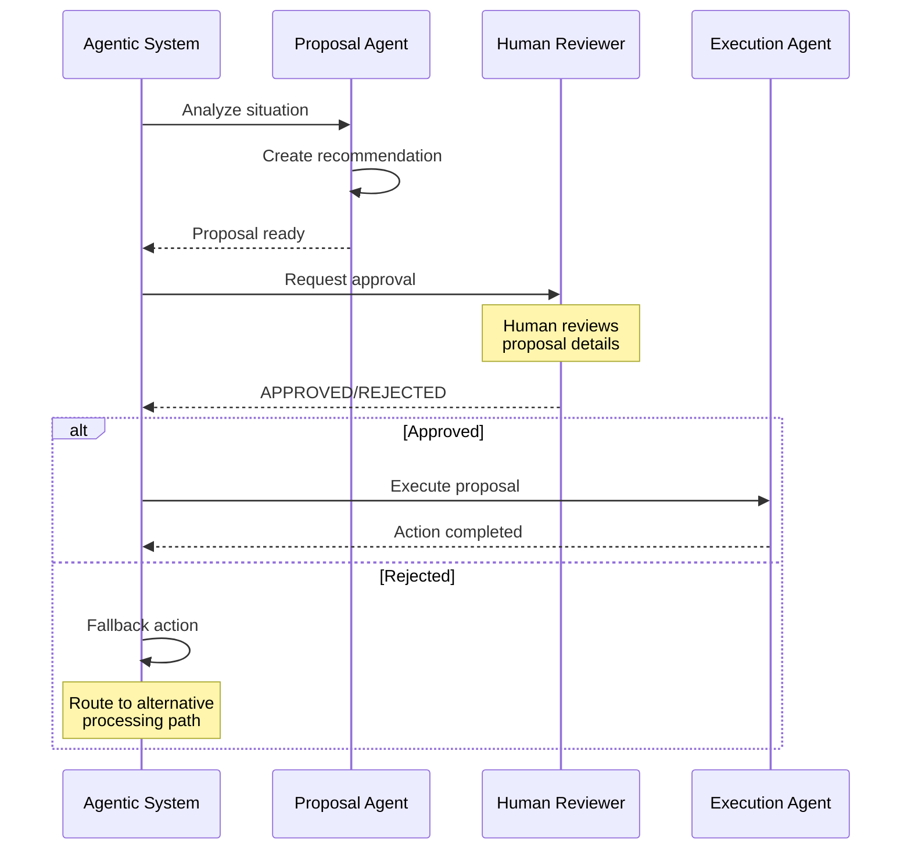
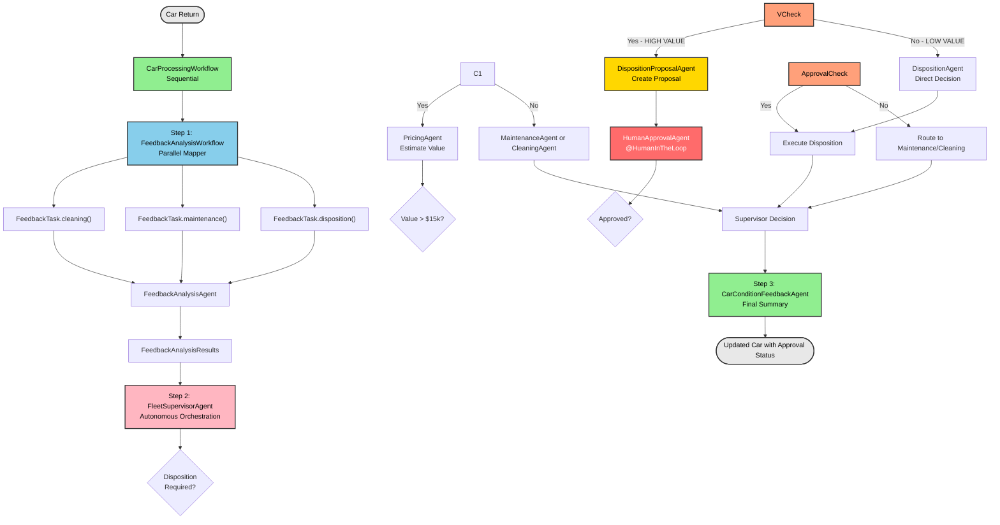
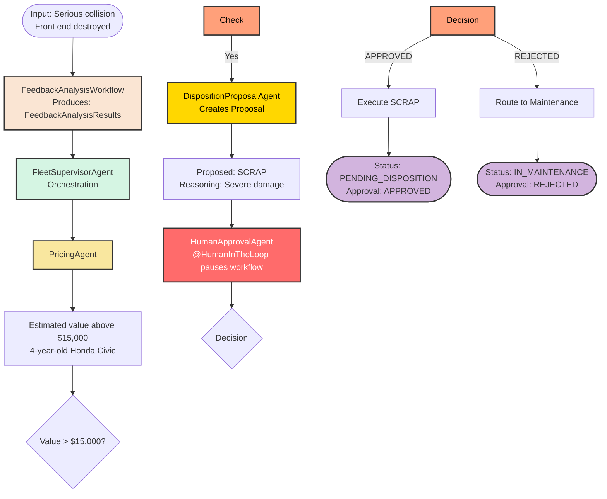
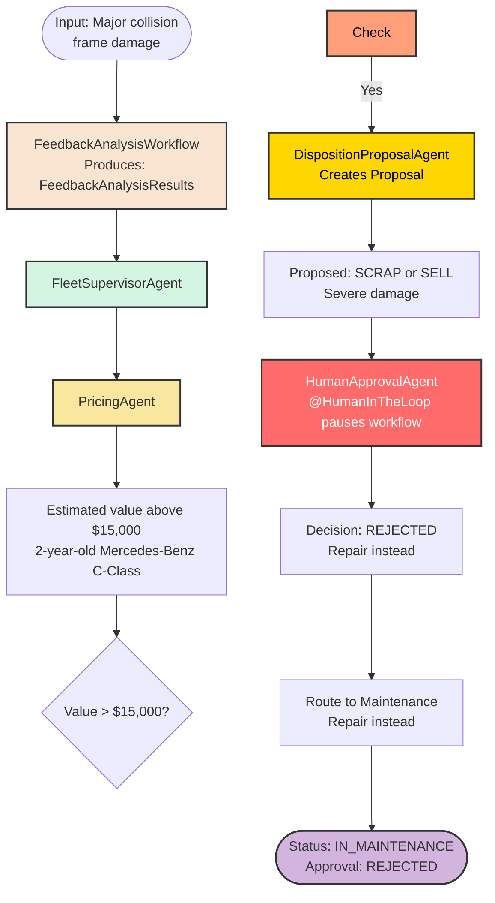
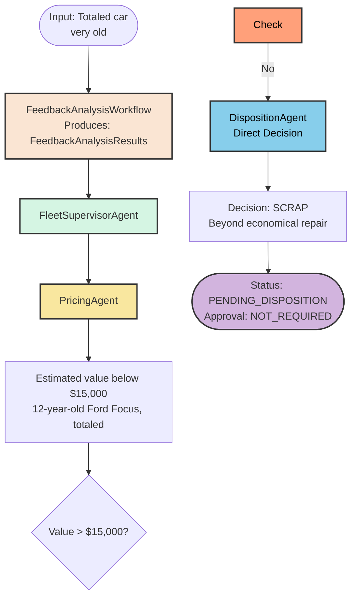

# Step 05 - Human-in-the-Loop Pattern

## Human-in-the-Loop Pattern

In the previous step, you built a **Supervisor Pattern** that orchestrates multiple agents to handle car returns, including disposition decisions for damaged vehicles.

However, that system made autonomous decisions about vehicle disposition without human oversight. What if you need **human approval** before executing high-stakes decisions, especially for valuable assets?

In this step, you'll learn about the **Human-in-the-Loop (HITL) pattern** - a critical approach where AI agents pause execution to request human approval before proceeding with significant actions.

---

## New Requirement from Miles of Smiles Management: Human Approval for High-Value Dispositions

The Miles of Smiles management team has now realized they may have been a bit too eager to give AI full decision powers: the system has been making autonomous disposition decisions on high-value vehicles without human oversight with some costly outcomes.

They want to implement a **human approval gate** with these requirements:

1. Any vehicle worth more than **$15,000** requires human approval before disposition
2. Track approval status and reasoning for compliance and audit trail

This ensures that expensive vehicles aren't scrapped or sold without proper human review.

---

## What You'll Learn

In this step, you will:

- Understand the **Human-in-the-Loop (HITL) pattern** and when to use it
- Implement a **two-phase approval workflow** (proposal → review → execution)
- Create a **DispositionProposalAgent** that generates proposals
- Build a **HumanApprovalAgent** using LangChain4j's **`@HumanInTheLoop`** annotation
- Modify the **FleetSupervisorAgent** to route high-value vehicles through approval
- Declare an agent as a **CDI bean class** so that it can inject a configuration value
- Pass a CDI bean to a `static` agent method with the **`@CdiBean`** annotation
- Add **approval tracking** to the data model
- Log every agent invocation with an **`AgentListener`** bean
- See how HITL provides **safety and control** in autonomous systems

---

## Understanding Human-in-the-Loop

### What is Human-in-the-Loop?

**Human-in-the-Loop (HITL)** is a pattern where:

- AI agents perform analysis and create recommendations
- Execution **pauses** to request human approval
- Humans review proposals and make final decisions
- System proceeds only after approval


### The Two-Phase Workflow



---


### The Complete HITL Architecture



---

## Implementing the Human-in-the-Loop Pattern

Let's build the HITL system step by step.

### Create the DispositionProposalAgent

This agent creates disposition proposals that will be reviewed by humans.

In `src/main/java/com/carmanagement/agentic/agents`, create `DispositionProposalAgent.java`:

**DispositionProposalAgent.java**
```java hl_lines="14-29 38-48 51"
{snippet:insert("section-2/step-05/src/main/java/com/carmanagement/agentic/agents/DispositionProposalAgent.java")}
```

> [!NOTE]
> **Why two disposition agents?**
> You might wonder why we have both DispositionProposalAgent and DispositionAgent. They serve different purposes: DispositionProposalAgent creates recommendations for human review on high-value vehicles (>$15K), while DispositionAgent makes autonomous decisions on lower-value vehicles. 


### Create the HumanApprovalAgent

This agent implements Human-in-the-Loop using LangChain4j's **`@HumanInTheLoop`** annotation. Instead of relying on a separate tool, the agent method itself **pauses workflow execution** until a human makes a decision through the UI.

In `src/main/java/com/carmanagement/agentic/agents`, create `HumanApprovalAgent.java`:

**HumanApprovalAgent.java**
```java hl_lines="6 15 26 35-39 42"
{snippet:insert("section-2/step-05/src/main/java/com/carmanagement/agentic/agents/HumanApprovalAgent.java")}
```

**Key Points:**

- The **`@HumanInTheLoop`** annotation from LangChain4j marks this agent method as requiring human interaction before completing
- It calls `ApprovalService.createProposalAndWaitForDecision()` which returns a `CompletableFuture`
- The Workflow execution **pauses** by calling `.get(5, TimeUnit.MINUTES)` on the future
- A human sees the pending approval in the UI and clicks Approve/Reject
- The future then completes and the workflow resumes with the human's decision
- It returns a message containing APPROVED/REJECTED and the reasoning
- The result is stored in the **AgenticScope** with key `approvalDecision`

The method needs the `ApprovalService`, which is a CDI bean. An agent interface cannot have injected fields, but its `static` methods can declare parameters that are resolved from CDI when they are annotated with `@CdiBean`, and this is what the last parameter of `reviewDispositionProposal()` does. Such a parameter is not an argument of the agent. It is not read from the AgenticScope and it is not described to the supervisor, which still sees an agent that takes the details of the car and of the proposal.


### The ApprovalService

The `ApprovalService` manages the `CompletableFuture` instances that pause and resume workflow execution. This is the bridge between the `HumanApprovalAgent` and the REST endpoints that the UI calls.

In `src/main/java/com/carmanagement/service`, create `ApprovalService.java`:

**ApprovalService.java**
```java
{snippet:insert("section-2/step-05/src/main/java/com/carmanagement/service/ApprovalService.java")}
```

**Key Points:**

- `CompletableFuture<ApprovalProposal>` is stored in a map keyed by car number
- the `createProposalAndWaitForDecision()` method creates the future and returns it
- The proposal is persisted in a separate transaction to ensure it's visible to UI queries
- The `processDecision()` method completes the future when human makes a decision
- This completion **resumes the workflow** that was blocked on `.get()`

### Create the ApprovalProposal Entity

This entity stores proposals in the database so the UI can display them.

In `src/main/java/com/carmanagement/model`, create `ApprovalProposal.java`:

**ApprovalProposal.java**
```java
{snippet:insert("section-2/step-05/src/main/java/com/carmanagement/model/ApprovalProposal.java")}
```

### Create the ApprovalResource

This REST resource allows the UI to fetch pending approvals and submit decisions.

Create `src/main/java/com/carmanagement/resource/ApprovalResource.java` to create the following REST API endpoints:

- `GET /api/approvals/pending` - Returns all pending approval proposals
- `POST /api/approvals/\{id}/approve` - Approve a proposal
- `POST /api/approvals/\{id}/reject` - Reject a proposal

In `src/main/java/com/carmanagement/resource`, create `ApprovalResource.java`:

**ApprovalResource.java**
```java
{snippet:insert("section-2/step-05/src/main/java/com/carmanagement/resource/ApprovalResource.java")}
```


> [!TIP]
> **How the HITL Flow Works End-to-End**
> 1. The `FleetSupervisorAgent` detects a high-value vehicle and invokes the `DispositionProposalAgent`
> 2. The proposal is passed to the `HumanApprovalAgent`, which is annotated with `@HumanInTheLoop`
> 3. Inside the agent method, `ApprovalService.createProposalAndWaitForDecision()` persists the proposal to the database and returns a `CompletableFuture`
> 4. The agent method **blocks** on `future.get(5, TimeUnit.MINUTES)` — the workflow pauses here
> 5. The UI polls `GET /api/approvals/pending` and displays the proposal to the human reviewer
> 6. The human clicks **Approve** or **Reject**, which calls the corresponding REST endpoint
> 7. `ApprovalService.processDecision()` completes the `CompletableFuture` with the decision
> 8. The agent method **unblocks**, formats the decision, and returns it
> 9. The workflow **resumes** with the human's decision

### Update the FleetSupervisorAgent

Now we need to modify the supervisor to implement the new value-based routing with the approval workflow.

The routing rule compares the value of the car with the approval threshold, and management wants to be able to move that threshold without anyone rewriting a prompt. The supervisor therefore reads it from the application configuration, and for this it needs an injected field. An agent interface cannot have one, so in this step `FleetSupervisorAgent` becomes a class. Quarkus LangChain4j accepts an agent in two forms. One is the interface, which every agent of this workshop has used so far, and the other is an ordinary CDI bean class. In both cases we don't implement the agentic method ourselves, because the extension does it at build time.

Update `src/main/java/com/carmanagement/agentic/agents/FleetSupervisorAgent.java`:

**FleetSupervisorAgent.java**
```java hl_lines="16 18-19 25-26 32 40 46 63-69 73"
{snippet:insert("section-2/step-05/src/main/java/com/carmanagement/agentic/agents/FleetSupervisorAgent.java")}
```

The supervisor gains `DispositionProposalAgent` and `HumanApprovalAgent` as sub-agents, and its request now tells the model to send a car worth more than the threshold through them and to call `DispositionAgent` directly otherwise. The other highlighted lines are what turns the interface into a bean:

- `approvalThreshold` is an injected field. `@ConfigProperty` fills it with the value of `car-management.approval.threshold`, the property we add to `application.properties` in [Update Application Configuration](#update-application-configuration) below.
- `superviseCarProcessing()` is declared `public native`. `native` is how Java lets a class declare a method without a body, and here it only marks the method as implemented by the extension at build time. No native library is involved.
- `request()` is no longer `static`. As an instance method, the `@SupervisorRequest` helper can read the injected field. It formats the threshold as a dollar amount and inserts it in the two routing rules, so the default of `15000` appears in the prompt as `$15,000`.

The class is a normal bean, so it could inject other beans in the same way, and any of its helper methods can use what it injects. A helper may be package-private, as `request()` is, but not `private` or `final`. The class itself has to be concrete and non-final with a no-arg constructor, and it declares exactly one agentic method. A scope annotation is optional, and we don't add one because without it the class is an `@ApplicationScoped` bean, the same scope agent interfaces get.

The supervisor is itself a sub-agent of `CarProcessingWorkflow`, which remains an interface, and its own sub-agents are interfaces too. Interface agents and class agents can be freely mixed as sub-agents of each other, and injecting and calling an agent is identical for both forms.

`HumanApprovalAgent` shows the other way of reaching a bean. It needs a single service inside a single `static` method, and a `@CdiBean` parameter is enough for that. The supervisor's helper depends on configuration, so we made the supervisor a bean and injected the value.

> [!NOTE]
> **The interface form remains available**
> Declaring an agent as an interface is the form shared with plain LangChain4j, and all the other agents of this workshop keep using it. The [Agents as CDI Beans](https://docs.quarkiverse.io/quarkus-langchain4j/dev/agentic.html#_agents_as_cdi_beans) section of the Quarkus LangChain4j guide covers the class form in more detail.

### Update the CarConditions Model

We also need to add the approval tracking fields to the data model.

Update `src/main/java/com/carmanagement/model/CarConditions.java`:

**CarConditions.java**
```java hl_lines="8-9 11-15 20-22"
{snippet:insert("section-2/step-05/src/main/java/com/carmanagement/model/CarConditions.java")}
```

### Update Application Configuration

And finally, add a new configuration value for the approval threshold so we can update it more easily when management changes their mind again.

Update `src/main/resources/application.properties`:

```properties
# Human-in-the-Loop configuration
# Threshold for requiring human approval on high-value dispositions
car-management.approval.threshold=15000
```

`FleetSupervisorAgent` injects this value into its `approvalThreshold` field and writes it into the routing rules of its request. Changing the amount that triggers a human review is therefore a matter of editing this one line.

---

## Try the Complete Solution

Now let's see the Human-in-the-Loop pattern in action!

### Start the Application

1. Navigate to the step-05 directory:


#### Linux / macOS

```bash
cd section-2/step-05
```

#### Windows

```cmd
cd section-2\step-05
```

2. Start the application:

#### Linux / macOS

```bash
./mvnw quarkus:dev
```

#### Windows

```cmd
mvnw quarkus:dev
```

3. Open [http://localhost:8080](http://localhost:8080)

### Test HITL Scenarios

Try these scenarios to see how the approval workflow handles different vehicle values:

#### Scenario 1: High-Value Vehicle Requiring Approval

Enter the following text in the feedback field for the **Honda Civic**:

```text
The car was in a serious collision. Front end is completely destroyed and airbags deployed.
```

**What happens:**



**Expected Result:**

- PricingAgent estimates a value above the approval threshold
- DispositionProposalAgent creates SCRAP proposal
- HumanApprovalAgent pauses the workflow (via `@HumanInTheLoop`) and waits for human input
- Human reviews the proposal in the UI and clicks Approve or Reject
- Workflow resumes with the decision
- Status: `PENDING_DISPOSITION` if approved, `IN_MAINTENANCE` if rejected

#### Scenario 2: High-Value Vehicle - Approval Rejected

Enter the following text in the **Mercedes Benz** feedback field:

```text
The car was in a major collision with frame damage, but the engine still runs.
```

**What happens:**



**Expected Result:**

- PricingAgent estimates a high value above the approval threshold
- DispositionProposalAgent creates a disposition proposal
- HumanApprovalAgent pauses workflow, human REJECTS the disposition proposal
- Fallback: Routes to MaintenanceAgent instead
- Status: `IN_MAINTENANCE`
- Disposition status: `DISPOSITION_REJECTED` with reasoning

#### Scenario 3: Low-Value Vehicle - No Approval Needed

Enter the following text in the **Ford Focus** feedback field in the Fleet Status grid:

```text
The car is totaled, completely inoperable, very old
```

**What happens:**



**Expected Result:**

- PricingAgent estimates a value below the approval threshold
- Skips approval workflow entirely (low value)
- DispositionAgent makes direct SCRAP decision
- Status: `PENDING_DISPOSITION`
- Approval status: `NOT_REQUIRED`

### Check the Logs

Watch the console output to see the approval workflow execution:

```bash
FeedbackAnalysisWorkflow executing...
  |- FeedbackAnalysisAgent(disposition): DISPOSITION_REQUIRED
FleetSupervisorAgent orchestrating...
  |- PricingAgent: Estimated value $18,000
  |- Value check: $18,000 > $15,000 -> Approval required
  |- DispositionProposalAgent: Proposed SCRAP
  |- HumanApprovalAgent (@HumanInTheLoop): Workflow paused...
  |- Waiting for human decision via UI...
  |- Human decision received: APPROVED
  |- Workflow resumed
CarConditionFeedbackAgent updating...
  |- Disposition status: DISPOSITION_APPROVED
```

Notice how the workflow **pauses** at the `HumanApprovalAgent` and only resumes after the human makes a decision in the UI.

---

## Recapping the HITL pattern

The HITL pattern provides a safety net for autonomous systems. Human review catches edge cases that AI might miss, preventing costly mistakes. It also builds trust by allowing a gradual transition from manual to autonomous operations, while maintaining clear human accountability for critical decisions.

Many industries require human oversight by regulation or policy. Financial services need approval for large transactions. Healthcare requires physician review of treatment decisions. Legal departments need lawyers to approve contract terms. Beyond compliance, audit trails that track who approved what and when are essential for accountability.

The real power of HITL is that you can tune the automation level over time:


Start with a low threshold where everything requires approval. As confidence grows, gradually increase the threshold so only higher-value decisions need human review. Eventually, routine cases can run fully autonomous while high-stakes decisions still go through HITL.

---


## Experiment Further

1. Try adjusting the approval threshold to see how it affects which vehicles require human review. The supervisor reads it from `car-management.approval.threshold`, so <mark>change the value in `application.properties` and submit one of the scenarios again</mark>. Lower it to `10000` to require approval for more vehicles, raise it to `25000` to only catch the most expensive ones, or set it to `0` to require approval for all dispositions.

1. You could implement multi-level approval where vehicles worth $15,000-$25,000 need a single approver, $25,000-$50,000 need two approvers, and anything over $50,000 requires manager approval.

1. Add monitoring to track approval rates by value range, average approval time, rejection reasons, and approver performance. Implement approval timeouts that auto-reject after 24 hours, escalate to a manager after 48 hours, or send reminder notifications. Build an approval history that tracks who approved or rejected each decision, when they made it, what reasoning they provided, and what the outcome was.

---

## Troubleshooting

<details class="warning">
<summary>All vehicles going through approval workflow</summary>

Check that the value threshold is correctly configured in `application.properties` and that the PricingAgent is returning numeric values that can be compared.

</details>


<details class="warning">
<summary>Workflow not pausing for human approval</summary>

Verify that:

- The `HumanApprovalAgent` has the `@HumanInTheLoop` annotation
- The `ApprovalService` is correctly creating the `CompletableFuture`
- The agent method is calling `.get()` on the future to block

</details>


<details class="warning">
<summary>Approval status not being tracked</summary>

Verify that:

- FleetSupervisorAgent stores disposition status in AgenticScope
- CarConditions model has the `dispositionStatus` and `dispositionReason` fields
- CarProcessingWorkflow retrieves these values from the scope

</details>


<details class="warning">
<summary>Low-value vehicles still requiring approval</summary>

Check the value comparison logic in FleetSupervisorAgent. Ensure the PricingAgent output is being parsed correctly as a number.

</details>


<details class="warning">
<summary>Timeout errors when waiting for approval</summary>

The `HumanApprovalAgent` has a 5-minute timeout by default. If you need more time, adjust the timeout value in the `.get(5, TimeUnit.MINUTES)` call. On timeout, the system defaults to REJECTED for safety.

</details>


---

## Agent Observability with MonitoredAgent and AgentListener

Beyond the HITL workflow, step-05 also introduces agent observability. This gives you the ability to inspect what every agent in the system did, what inputs it received, what it produced, and how long it took.

LangChain4j provides the `MonitoredAgent` interface and an `HtmlReportGenerator` utility in the `dev.langchain4j.agentic.observability` package. Together, they give you a full execution report of your agentic system with zero manual instrumentation.

The `MonitoredAgent` interface has a single method that returns an `AgentMonitor`. When your top-level workflow interface extends `MonitoredAgent`, LangChain4j automatically attaches an `AgentMonitor` listener to the entire agent tree. This monitor implements `AgentListener` and records every agent invocation across the system.

Before each invocation, it captures the agent name, inputs, and start time. After each invocation, it captures the output and finish time. On errors, it captures exception details. For nested invocations, it tracks the full call hierarchy, such as when FleetSupervisorAgent calls PricingAgent which calls DispositionProposalAgent. The monitor groups executions by memory ID so you can inspect each independent workflow run separately.

Enabling this feature requires two simple steps. First, make your workflow interface extend `MonitoredAgent`. In `CarProcessingWorkflow.java`, the interface simply extends `MonitoredAgent` with no other changes needed. The framework handles everything automatically without requiring annotations on individual agents or manual tracking code.

Second, generate an HTML report from the monitor. In `CarManagementService.java`, the `report()` method uses the static `HtmlReportGenerator.generateReport()` helper to produce a self-contained HTML page. This page includes an agent topology showing a visual map of all agents and their relationships, an execution timeline with a detailed breakdown of every agent invocation including inputs, outputs, duration, and nesting level, and error tracking that highlights any failed invocations with their exception details.

The report is exposed via a REST endpoint in `CarManagementResource.java`. After processing one or more cars, click the "Generate Report" button in the UI (next to "Refresh Data") to open the report in a new tab. The report shows the full agent topology of your system, every execution grouped by workflow run, and for each agent invocation, what went in, what came out, and how long it took. This is invaluable for debugging agent behavior, understanding why the supervisor made a particular routing decision, or verifying that the HITL workflow paused and resumed correctly.

The report shows what the agents did once you ask for it. To see the agents at work while a car is being processed, step-05 also contains a listener of its own. `AgentListener`, the interface that the monitor implements, can be implemented by the application as well, and `AgentLoggingListener` uses it to write a log line whenever an agent starts, completes or fails.

**AgentLoggingListener.java**
```java
{snippet:insert("section-2/step-05/src/main/java/com/carmanagement/agentic/observability/AgentLoggingListener.java")}
```

The listener needs no registration code. An `AgentListener` bean, which must be `@ApplicationScoped` or `@Singleton`, is registered by Quarkus LangChain4j on every agent of the application, with no annotation on the agents. Each of the three callbacks writes one line, and `abbreviate()` keeps an agent's output on that line by replacing its line breaks with spaces and cutting it after 60 characters.

In the callbacks the agent name is the name of the agentic method, so the supervisor is logged as `superviseCarProcessing` and the approval agent as `reviewDispositionProposal`. <mark>Submit one of the scenarios again and watch the terminal where Quarkus is running.</mark> Every agent that runs logs one message when it starts and another when it completes. The following lines illustrate their format for the approval agent, with the output left as a placeholder:

```text
Agent reviewDispositionProposal started
Agent reviewDispositionProposal completed: <first 60 characters of the output>...
```

The console puts its usual timestamp, level and logger name in front of each message. For the approval agent the second line only appears when its method returns, after you approve or reject the proposal in the UI or after the five-minute timeout, which makes the pause of the workflow visible in the log. An agent that fails produces a warning of the form `Agent <name> failed: <exception message>`.

---
## Cleanup

Before moving to the next step, let's clean up:

1. **Stop the running server** by pressing `Ctrl+C` in the terminal where Quarkus is running

2. **Return to the root project directory**:

    ```bash
    cd ..
    ```

---


## What's Next?

You've successfully implemented the Human-in-the-Loop pattern for safe, controlled autonomous decision-making. The system now routes high-value vehicles through human approval using LangChain4j's `@HumanInTheLoop` annotation, creates proposals for human review via the DispositionProposalAgent, and pauses workflow execution in the HumanApprovalAgent until a human decides. It tracks approval decisions for audit trails, provides fallback paths for rejected proposals, and balances automation with human oversight.

In **Step 06**, you'll learn about **multimodal image analysis** — allowing employees to upload car photos during rental returns, so the system can automatically enrich feedback with visual observations using a multimodal AI agent!

[Continue to Step 06 - Multimodal Image Analysis](../step-06/)
