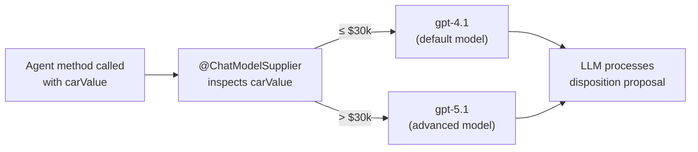
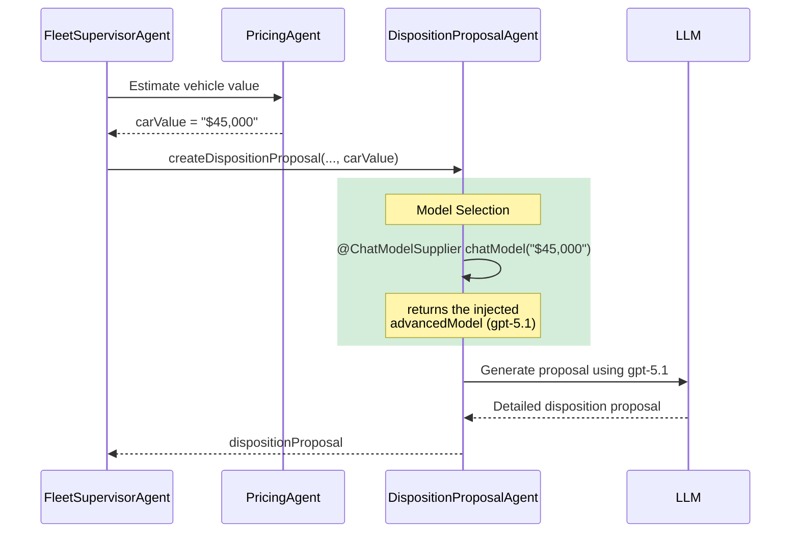

# Step 07 - Dynamic Model Selection

## New Requirement: Smarter Decisions for High-Value Vehicles

In Step 6, you enhanced the system with multimodal image analysis, giving the workflow visual context alongside textual feedback. The system now makes well-informed disposition decisions, but there's a catch: every decision uses the same LLM model, regardless of how much is at stake.

The Miles of Smiles management team has noticed that disposition proposals for high-value vehicles deserve more careful reasoning. A $50,000 car scrapped by mistake is far more costly than a $3,000 one. They want the system to automatically use a more capable (and more expensive) model when the stakes are high, while keeping costs down for routine decisions on lower-value vehicles.

In this step you'll implement **dynamic model selection**: the `DispositionProposalAgent` will automatically switch to an advanced LLM when the vehicle's estimated value exceeds $30,000.

---

## What You'll Learn

In this step, you will:

- Configure **multiple named AI models** in a single Quarkus application
- Turn `DispositionProposalAgent` into a **bean class** that injects both models and chooses one of them based on runtime data
- Use the **`@ChatModelSupplier`** annotation to dynamically select a model per agent invocation
- Understand how **`@ModelName`** qualifies named model injection in Quarkus LangChain4j

---

## Understanding Dynamic Model Selection

### Why Not Use the Same Model for Everything?

Using a single model for all decisions is simple, but it forces a trade-off between cost and quality. A cheaper model handles most routine decisions perfectly well, but may miss nuances on complex, high-stakes cases. A more capable model produces better reasoning, but running it for every request is wasteful when most cars in the fleet are low-to-mid-value vehicles.

Dynamic model selection lets you have both: route high-value decisions to a stronger model and keep everything else on the cost-effective default.

### How It Works in LangChain4j

LangChain4j's `@ChatModelSupplier` annotation marks the method that provides the `ChatModel` of an agent. This method can take parameters, which are resolved from the AgenticScope, so it can receive the outputs of agents that ran earlier in the workflow. Here it receives `carValue`, the estimate produced by the `PricingAgent`, and it is invoked at each invocation of the agent. The model choice can therefore depend on the actual data flowing through the workflow at runtime, not just on static configuration.

In an agent interface the supplier is a `static` method, whereas in an agent class it is an instance method, which can return one of the models that the class injects. This second form is the one `DispositionProposalAgent` takes in this step.



---

## Prerequisites

Before starting:

- **Completed [Step 06](../step-06/)** — This step builds on Step 6's architecture
- Application from Step 06 is stopped (Ctrl+C)
- Understanding of Step 5's disposition workflow (DispositionProposalAgent, HumanApprovalAgent)

---

## Configure the Named Models

The first change is in `application.properties`. In previous steps, the application had a single unnamed model configuration that every agent shared. Now we configure two models: a default model used by all agents unless overridden, and a named `advancedModel` used selectively for high-value decisions.

<mark>Open `src/main/resources/application.properties`</mark> and update the AI model configuration:

**application.properties**
```properties
{snippet:insert("section-2/step-07/src/main/resources/application.properties:27", "39")}
```

The default (unnamed) model uses `gpt-4.1` — a cost-effective model that handles routine disposition decisions well. The named `advancedModel` uses `gpt-5.1`, which provides stronger reasoning for complex cases. The naming convention follows the Quarkus LangChain4j pattern: `quarkus.langchain4j.openai.<modelName>.*` defines a model you can later inject with `@ModelName("<modelName>")`.

All other agents in the application (FeedbackAnalysisAgent, PricingAgent, FleetSupervisorAgent, etc.) continue to use the default model automatically — no changes needed anywhere else.

---

## Update the DispositionProposalAgent

The `DispositionProposalAgent` is the agent that creates disposition proposals — SCRAP, SELL, DONATE, or KEEP — based on the vehicle's value, condition, age, and damage. It is the natural place for dynamic model selection because the quality of its reasoning directly determines whether a valuable car is handled correctly.

To choose between the two models, the agent first needs a reference to both of them. An interface has no fields to inject them into, so `DispositionProposalAgent` becomes a bean class, in the same way as `FleetSupervisorAgent` in [Step 05](../step-05/), and gains a supplier method that returns one of the injected models.

<mark>Open `src/main/java/com/carmanagement/agentic/agents/DispositionProposalAgent.java` and update the highlighted lines:</mark>

**DispositionProposalAgent.java**
```java hl_lines="4-5 8-10 17 19-26 68 77-95"
{snippet:insert("section-2/step-07/src/main/java/com/carmanagement/agentic/agents/DispositionProposalAgent.java")}
```

The agent is now declared as a `class` and `createDispositionProposal` is `public native`, while its prompts and its `@Agent` annotation are unchanged. The other highlighted lines select the model:

- The two `ChatModel` fields are ordinary injections. The field without a qualifier receives the default model (`gpt-4.1`), and `@ModelName("advancedModel")` selects the named configuration (`gpt-5.1`) for the second one. Injecting a model does not make the agent use it, since the model of this agent is the one that its supplier returns.
- `chatModel()` is the `@ChatModelSupplier` method. It is invoked at each invocation of `createDispositionProposal` and, as an instance method, it can return either of the two injected fields.
- The `carValue` parameter of the supplier is resolved from the AgenticScope, so it receives the estimate that the `PricingAgent` wrote there under its `carValue` output key earlier in the workflow.
- `parseValue()` extracts the digits from the estimate, which arrives formatted as something like `"$42,500"`, and the supplier compares the result against `HIGH_VALUE_THRESHOLD`. A value above $30,000 selects the advanced model and writes a line to the log, while everything else stays on the default.

A $10,000 car therefore goes to `gpt-4.1` and a $45,000 car to `gpt-5.1`, with the same system message, user message template and output key in both cases.

---

## Try It Out

### Start the Application

1. Navigate to the step-07 directory:

```bash
cd section-2/step-07
```

2. Start the application:

#### Linux / macOS

```bash
./mvnw quarkus:dev
```

#### Windows

```cmd
mvnw quarkus:dev
```

3. Open [http://localhost:8080](http://localhost:8080)

### Test with a Standard-Value Vehicle

Find the Honda Civic in the Fleet Status grid and enter feedback describing severe damage:

```text
The car was involved in a severe collision, with heavy front-end damage, rear bumper damage, and possible frame damage. It may not be safe to drive.
```

Click **Return**.

This feedback is intentionally severe so the disposition analysis is activated. The Honda Civic should still be below the $30,000 advanced-model threshold, so the `DispositionProposalAgent` will use the default `gpt-4.1` model. Check the application logs. You should see the disposition proposal generated without the advanced model being invoked.

### Test with a High-Value Vehicle

Now try a scenario where the PricingAgent estimates a value above $30,000. Find the Mercedes-Benz C-Class in the Fleet Status grid and enter feedback describing severe damage:

```text
The car was involved in a severe multi-car rear-end collision, with heavy damage to both the front and rear bumpers and possible structural damage.
```

Click **Return**.

This time, when the PricingAgent returns a high estimated value (above $30,000), the `DispositionProposalAgent` will automatically switch to the `gpt-5.1` model. The more capable model provides stronger reasoning for the disposition decision on this valuable vehicle. In this case the agent also logs its choice, in a line whose message ends with the value estimated by the PricingAgent:

```text
Selecting advanced model for high-value car estimated <carValue>
```

### Verify the Model Switch

Enable request logging to see which model is being used:

```properties
quarkus.langchain4j.log-requests=true
```

In the logs, look for the model name in the request payload. You'll see `gpt-4.1` for low-value vehicles and `gpt-5.1` for high-value ones.

---

## How It All Works Together



---

## Key Takeaways

- **Named models** in `application.properties` let you configure multiple LLM backends in the same application, each with its own model, temperature, and timeout settings
- **`@ModelName`** qualifies which named model to inject into a CDI bean
- **`@ChatModelSupplier`** marks the method that provides the `ChatModel` of an agent. In an agent class it is an instance method
- An agent declared as a **bean class** injects the models it chooses from. An injected `ChatModel` field never selects the model of the agent by itself, since this is what the supplier's return value does
- **Supplier parameters** are resolved from the AgenticScope, so the supplier, invoked at each invocation of the agent, can read the outputs of earlier agents and select the model from them without extra plumbing
- The model selection sits in a single method of the agent class, and the agent's **prompts and output handling** don't change at all

---

## Experiment Further

### 1. Adjust the Threshold

Change the `HIGH_VALUE_THRESHOLD` in `DispositionProposalAgent` to a lower value (e.g., 10000) and observe how more vehicles get routed to the advanced model. Watch the logs to confirm the switch.

### 2. Add a Third Model Tier

Configure a third named model, for example `premiumModel`, for vehicles above $100,000, replacing the placeholder with a model of your choice:

```properties
quarkus.langchain4j.premiumModel.chat-model.provider=openai
quarkus.langchain4j.openai.premiumModel.chat-model.model-name=<your-premium-model>
quarkus.langchain4j.openai.premiumModel.api-key=$\{OPENAI_API_KEY}
quarkus.langchain4j.openai.premiumModel.timeout=PT180S
```

Then inject it into `DispositionProposalAgent` with `@ModelName("premiumModel")` and extend the supplier to a three-tier selection.

### 3. Apply Dynamic Selection to Other Agents

Try adding `@ChatModelSupplier` to other agents in the system. For example, the `FleetSupervisorAgent` could use a more capable model when the overall disposition involves multiple damaged vehicles.

### 4. Make the Threshold Configurable

Replace the hardcoded `HIGH_VALUE_THRESHOLD` with a Quarkus configuration property using `@ConfigProperty`, as `FleetSupervisorAgent` does for its approval threshold since Step 05, so it can be tuned without recompilation:

```java
@ConfigProperty(name = "car-management.advanced-model.threshold", defaultValue = "30000")
int highValueThreshold;
```

---

## Troubleshooting

<details class="warning">
<summary>Bean resolution error for advancedModel</summary>

If you see `UnsatisfiedResolutionException` for the `@ModelName("advancedModel")` injection, verify that the named model is fully configured in `application.properties`. The name in `@ModelName("advancedModel")` must match the segment in `quarkus.langchain4j.openai.advancedModel.*` exactly.

</details>


<details class="warning">
<summary>All requests using the same model</summary>

If you see the same model in all requests regardless of car value, check that:

- The `carValue` parameter reaching the agent is correctly formatted (e.g., `"$42,500"`)
- The `parseValue` method can extract digits from the format used by your PricingAgent
- The threshold in `DispositionProposalAgent` matches your test data

</details>


<details class="warning">
<summary>ChatModelSupplier method not being called</summary>

In an agent class the `@ChatModelSupplier` method is an instance method, which may be package-private but not `private` or `final`. Verify that it returns `ChatModel` and that the agentic method carries no `@ModelName` annotation, because `@ModelName` on the agentic method and a `@ChatModelSupplier` cannot be used on the same agent. The `ChatModel` fields injected into the class never select the model by themselves, so the agent only switches when the supplier returns the advanced one.

</details>


---

## Cleanup

Before moving to the next step:

1. **Stop the running server** by pressing `Ctrl+C` in the terminal where Quarkus is running

2. **Return to the root project directory**:

    ```bash
    cd ..
    ```

---

## What's Next?

You've successfully implemented dynamic model selection, giving the system cost-effective reasoning for routine decisions and more capable analysis for high-value vehicles.

The system now:

- Configures multiple named AI models in a single application
- Automatically selects the appropriate model based on the vehicle's estimated value
- Uses a stronger model for high-value disposition decisions without changing agent prompts or workflow structure

**Key Progression:**

- **Step 4**: Sophisticated local orchestration with Supervisor Pattern
- **Step 5**: Human-in-the-Loop for safe, controlled autonomous decisions
- **Step 6**: Multimodal image analysis for enriched feedback
- **Step 7**: Dynamic model selection for cost-effective, risk-aware decisions

In **Step 08**, you'll learn about **Agent-to-Agent (A2A) communication** — converting the local PricingAgent into a remote service that runs in a separate system, demonstrating how to distribute agent workloads across multiple applications!

[Continue to Step 08 - Using Remote Agents (A2A)](../step-08/)
